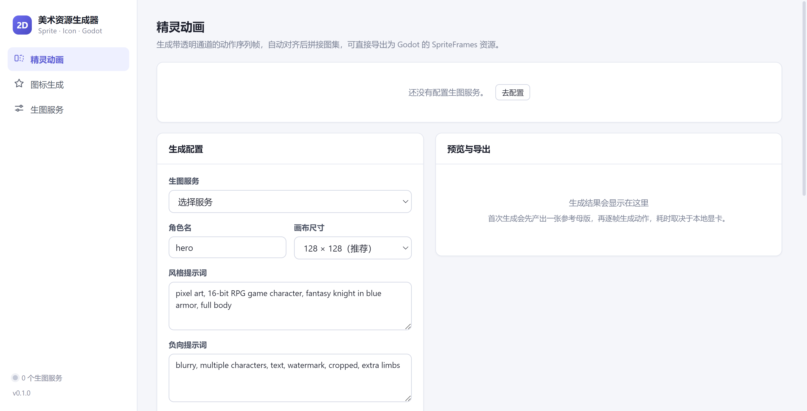

# 2D 游戏美术资源生成器

> 把「提示词 → 精灵动画帧 → Godot 资源」变成一条可复用流水线的桌面工具。




面向独立开发者和小团队的 2D 素材生成器。它不是又一个生图聊天框，而是把游戏美术的产出流程拆成可配置、可复现、可批量重跑的工程管线：**生成 → 去底 → 对齐 → 校验 → 拼图 → 导出引擎资源**。

## 解决什么问题

用 AI 生图做 2D 游戏素材，卡点从来不是「画一张好看的图」，而是这三件事：

| 问题 | 本项目的做法 |
| --- | --- |
| 每帧角色长得都不一样，动画抖成幻灯片 | 首帧作参考母版，后续帧走 img2img 继承；程序化生成 OpenPose 骨架序列，用 ControlNet 锁死姿态 |
| 生成的图有底色、主体位置飘、帧与帧对不齐 | 边缘洪水填充去底 + 羽化，alpha bbox 裁切，脚底基线对齐，统一画布，偏差超阈值自动标红 |
| 出图了还要手动切图、命名、进引擎建动画 | 一键输出横向图集 + `SpriteFrames.tres`，Godot 里直接挂 `AnimatedSprite2D` |

## 核心特性

- **精灵动画帧生成** — 指定动作、帧数、帧率，自动逐帧生成、去底、对齐、校验并拼接图集
- **姿态约束一致性** — 内置程序化 OpenPose 骨架（待机 / 行走 / 奔跑 / 攻击），按服务能力自动判定一致性等级 A / B / C 并明确告知
- **多生图后端，页面内配置** — 本地 Stable Diffusion（WebUI / ComfyUI）、OpenAI 兼容接口、自定义 HTTP，一个界面统一管理
- **风格锚定与可复现** — 参考母版 + 固定种子 + 参数快照（`meta.json`），同一组配置可稳定重跑
- **图标批量生成** — 同风格物品图标，自动去底居中
- **Godot 4 一键导出** — 图集 PNG + `.tres` + 图集 JSON + 生成参数
- **动画预览** — Canvas 播放、洋葱皮、逐帧步进，方便核对帧间连贯性

## 快速开始

### 环境要求

- Node.js 18+（开发环境使用 22）
- 生图后端二选一：
  - 本地 **Stable Diffusion WebUI**（推荐，支持 ControlNet，动画帧一致性最好）
  - 本地 **ComfyUI**

### 安装与运行

```bash
git clone https://github.com/shiyi25928988/2D-Game-Res-Generator.git
cd 2D-Game-Res-Generator
npm install
npm run dev
```

### 打包

```bash
npm run build   # 构建产物到 out/
npm run dist    # 生成安装包到 release/
```

## 使用流程

1. **配置生图服务** — 左侧「生图服务」→ 添加 → 填地址、模型、ControlNet 模型 → 测试连接
2. **定义角色与动作** — 角色名、风格提示词、动作、帧数、帧率
3. **选择素材输出目录**
4. **生成** — 实时进度推送，可随时取消；先出参考母版，再逐帧生成
5. **预览与校验** — 洋葱皮检查连贯性，标红帧调参后重生成
6. **导出到 Godot** — 选择项目根目录，写入 `assets/generated/<角色名>/`

导出结构：

```
<godot 项目>/assets/generated/<角色名>/
  ├── idle.png          # 横向图集
  ├── idle.tres         # SpriteFrames，可直接挂到 AnimatedSprite2D
  ├── idle.json         # 通用图集信息
  ├── idle.meta.json    # 生成参数（模型 / seed / 提示词），用于复现
  └── frames/           # 独立帧，便于单帧替换
```

> 不生成 `.import` 文件，交给 Godot 自己导入，避免不同版本间的导入格式冲突。

## 生图服务配置

### 本地 SD · WebUI（推荐）

1. 启动时加参数：

```bash
./webui.sh --api --cors-allow-origins=*
```

2. 地址填 `http://127.0.0.1:7860`，模型填 checkpoint 文件名
3. **ControlNet 模型**填已安装的 openpose 模型名（如 `control_v11p_sd15_openpose [cab727d4]`）
   - 已填 → 一致性等级 **A**（母版 img2img + OpenPose 约束 + 固定 seed）
   - 留空 → 等级 **B**（仅 img2img）
   - 模型名可在 WebUI 的 ControlNet 面板查看

### 本地 SD · ComfyUI

默认 `http://127.0.0.1:8188`。不填工作流模板时使用内置 txt2img / img2img 工作流，模型名需与 ComfyUI 内 checkpoint 命名一致。

自定义模板支持占位符：

```
{{prompt}} {{negative}} {{width}} {{height}} {{seed}}
{{steps}} {{cfg}} {{denoise}} {{ckpt}} {{sampler}} {{initImage}}
```

### OpenAI 兼容 / 自定义 HTTP

- **OpenAI 兼容** — 填 baseUrl 与 API Key，模型名如 `gpt-image-1`。多数接口不支持 img2img，动画帧会退化为 **C** 级（仅适合小幅待机动作）
- **自定义 HTTP** — 填生成接口路径、请求体模板、响应中图片的提取路径（如 `data.0.b64_json`），可对接自建服务

API Key 通过 Electron `safeStorage` 加密后落盘，界面不回显明文。

## 测试

无需显卡即可回归整条管线：

```bash
npm run typecheck   # 主进程 + 渲染进程类型检查
npm run selftest    # 图像管线自检：去底 / 对齐 / 拼图 / Godot 导出格式
npm run e2e         # 端到端：内置模拟 SD 服务，跑通完整生成链路
npm run smoke       # 真实启动应用，检查界面渲染后自动退出（需先 build）
```

`e2e` 会起一个本地 HTTP 服务模拟 SD WebUI 的 `/sdapi/v1/*` 接口，验证「母版 → 多帧生成 → ControlNet 调用 → 去底对齐 → 图集 → `.tres` 导出」全链路，因此改管线不用每次都开显卡。

## 项目结构

```
src/
├── main/                 # 主进程
│   ├── providers/        # 生图服务适配器（WebUI / ComfyUI / OpenAI / 自定义 HTTP）
│   ├── pipeline/         # 生成管线（精灵动画、图标）
│   ├── image/            # 去底、裁切、对齐、拼图、姿态骨架
│   ├── exporter/         # Godot 导出
│   ├── store/            # 配置持久化 + 密钥加密
│   └── ipc.ts            # IPC 路由（白名单）
├── preload/              # contextBridge 受限 API
├── renderer/             # Vue 3 界面
└── shared/               # 主/渲染共享类型
docs/
├── 项目方案.md            # 定位、范围、里程碑、风险
└── 技术设计.md            # 管线设计、Provider 接口、导出格式
```

## 已知限制

- **生成质量取决于后端能力** — C 级服务（仅 txt2img）出的动画帧一致性有限，这是模型能力上限，工具只负责如实提示
- **瓦片集与 UI 九宫格未实现** — 见 `docs/项目方案.md` 里程碑 M4
- **仅导出 Godot** — Unity / Godot 3 的资源格式待补，图集 JSON 已通用

## 常见问题

**启动报 `Cannot read properties of undefined (reading 'isPackaged')`**

环境里设置了 `ELECTRON_RUN_AS_NODE=1`，会让 Electron 以纯 Node 模式启动。清除该变量后重试：

```bash
unset ELECTRON_RUN_AS_NODE
```

`npm run smoke` 已自动处理。

**`npm install` 时 Electron 二进制下载失败**

国内网络可通过镜像单独下载运行时：

```bash
ELECTRON_MIRROR="https://registry.npmmirror.com/-/binary/electron/" node node_modules/electron/install.js
```

## 文档

- [项目方案](docs/项目方案.md) — 产品定位、MVP 范围、里程碑与风险
- [技术设计](docs/技术设计.md) — 管线设计、Provider 适配器接口、数据模型、导出格式

## License

[MIT](LICENSE)
